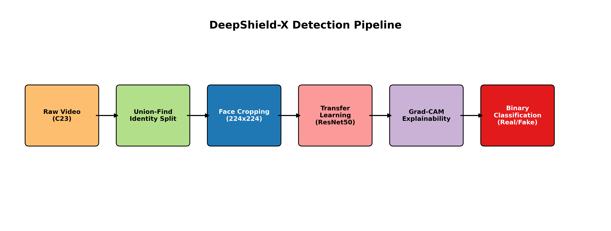
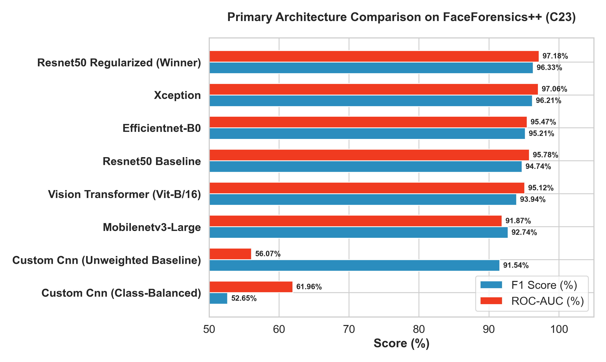
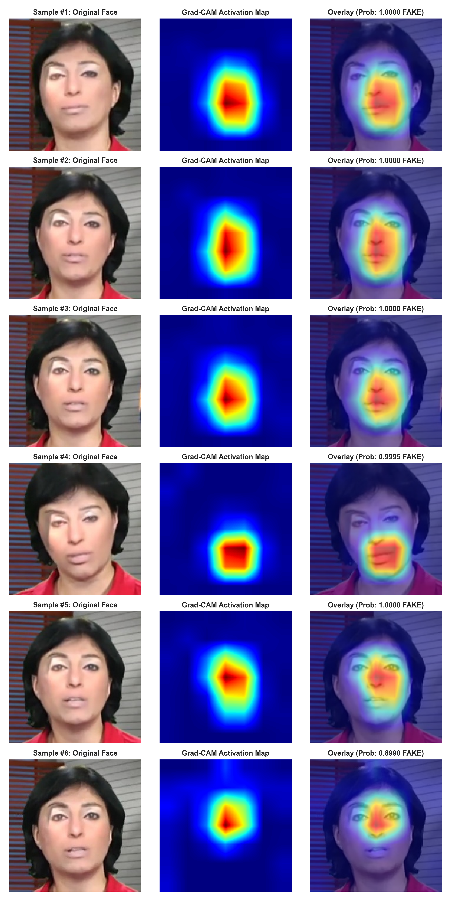

# DeepShield-X

DeepShield-X is a deepfake detection and facial forensics project built on **FaceForensics++ (C23)**. It combines a reproducible PyTorch benchmarking pipeline (evaluating six CNN and Vision Transformer backbones under an identity-disjoint split) with a full-stack **FastAPI + React** web application for running inference, inspecting Grad-CAM heatmaps, and exploring experiment diagnostics.

---

## Why I Built This

Most deepfake detection tutorials report 95%+ accuracy on FaceForensics++, but those numbers often break down on closer inspection for two reasons:

1. **Identity leakage between splits:** FaceForensics++ applies multiple manipulation algorithms to the same pool of original videos. If frames or videos are split randomly, the same actor appears in both training and test sets, allowing a high-capacity network to memorize faces instead of learning forgery artifacts.
2. **Class imbalance masking model collapse:** Manipulated crops outnumber authentic crops by roughly 6:1. An unweighted binary classifier can predict "fake" on every single image and still score **84.40% accuracy** with **0.00% specificity**.

DeepShield-X was built to isolate and solve both issues first, audit where detectors still fail (such as NeuralTextures mouth reenactments and heavy JPEG compression), and expose the trained models through a practical forensic web interface.

---

## Pipeline Overview

<p align="center">
  
</p>

1. **Identity-Disjoint Splitting (`Research/src/data/splitting.py`):** Source and target actor IDs parsed from FaceForensics++ filenames (`001.mp4`, `435_456.mp4`, `01_02__...`) are modeled as an undirected graph and grouped into connected components using Disjoint-Set Union-Find with path compression. Each component is assigned atomically to train, validation, or test so no tracked identity crosses splits.
2. **Face Extraction:** Video frames are sampled at stride 10. Detected face bounding boxes are expanded by `1.3x` to retain blending seams along the jawline and forehead, then resized to `224x224`.
3. **Imbalance-Aware Training:** Models output a single logit trained with weighted `BCEWithLogitsLoss` (`pos_weight = 6964 / 43742 = 0.1592` to equalize class loss contributions), AdamW (`lr = 1e-4`, weight decay `1e-4`), and cosine annealing with a 2-epoch warmup (seed `42`).
4. **Forensic Web App (`backend/` + `Frontend/`):** Uses OpenCV YuNet face detection, dual-view face + biological core probability fusion, temporal video aggregation (median + 10% trimmed mean), and Grad-CAM overlay generation.

---

## Dataset Splits (FaceForensics++ C23)

| Split | Authentic (Real) | Manipulated (Fake) | Total Crops | Fake:Real Ratio |
| :--- | :---: | :---: | :---: | :---: |
| **Train** | 6,964 | 43,742 | 50,706 | 6.28 : 1 |
| **Validation** | 1,497 | 7,481 | 8,978 | 5.00 : 1 |
| **Held-Out Test** | 1,496 | 8,093 | 9,589 | 5.41 : 1 |
| **Total** | **9,957** | **59,316** | **69,273** | **5.96 : 1** |

On the held-out test split ([test.csv](Research/data/splits/test.csv)), `963` video sequences spanning `155` tracked actor IDs resolve into `76` disjoint connected components.

---

## Benchmark Results (Held-Out Test Set, N = 9,589)

All models were evaluated on the frozen test partition at a fixed threshold of `0.50` without test-set threshold tuning:

| Model | Params | Accuracy | Precision | Recall | Specificity | F1 Score | ROC-AUC | PR-AUC | MCC |
| :--- | :---: | :---: | :---: | :---: | :---: | :---: | :---: | :---: | :---: |
| **ResNet50 (Regularized)** | 23.5M | **93.89%** | 97.55% | **95.14%** | 87.10% | **0.9633** | **0.9718** | **0.9938** | **0.7821** |
| **Xception** | 20.8M | 93.70% | **97.77%** | 94.70% | **88.30%** | 0.9621 | 0.9706 | 0.9931 | 0.7798 |
| **EfficientNet-B0** | 4.0M | 92.08% | 97.21% | 93.30% | 85.49% | 0.9521 | 0.9547 | 0.9879 | 0.7290 |
| **ViT-Small/16** | 21.7M | 90.05% | 96.63% | 91.40% | 82.75% | 0.9394 | 0.9512 | 0.9894 | 0.6706 |
| **MobileNetV3-Small** | 1.5M | 87.97% | 94.44% | 91.10% | 70.99% | 0.9274 | 0.9187 | 0.9820 | 0.5792 |
| **ResNet50 (Baseline)** | 23.5M | 91.33% | 97.09% | 92.50% | 85.03% | 0.9474 | 0.9578 | 0.9914 | 0.7087 |
| **Custom CNN (Balanced)** | 93.8K | 43.24% | 88.95% | 37.39% | 74.87% | 0.5265 | 0.6196 | 0.8966 | 0.0987 |
| **Custom CNN (Unweighted)** | 93.8K | 84.40% | 84.40% | 100.00% | 0.00% | 0.9154 | 0.5607 | 0.8799 | 0.0000 |

<p align="center">
  
</p>

### Key Empirical Findings

- **ResNet50 vs. Xception:** Regularized ResNet50 leads on Accuracy (`93.89%`), F1 (`0.9633`), ROC-AUC (`0.9718`), and MCC (`0.7821`), while Xception leads on Precision (`97.77%`) and Specificity (`88.30%`). Their 1,000-iteration bootstrap 95% CIs overlap (`[0.9603, 0.9663]` vs `[0.9591, 0.9653]`).
- **CNNs vs. ViT-Small/16:** At matched ~21M parameter budgets, ResNet50 and Xception outperform `vit_small_patch16_224` on compressed facial frames, likely because `16x16` patch tokenization fragments narrow blending seams.
- **NeuralTextures Blind Spot:** Five of six FF++ manipulations achieve >96% recall under ResNet50, but **NeuralTextures** drops to `85.36%` and accounts for **219 of 393 false negatives (55.7%)** because its edits are confined to the mouth region and get diluted by global average pooling.
- **JPEG Compression Cliff:** On a 502-image perturbation sweep, recall stays at `96.41%` at JPEG Q=70, drops to `72.51%` at Q=50, and collapses to `39.64%` at Q=30.
- **Calibration & Grad-CAM:** ResNet50 Regularized achieves `ECE = 4.07%` and `Brier = 0.0499`. Grad-CAM maps confirm activation along jawline/chin blending seams for face swaps and perioral regions for facial reenactments.

<p align="center">
  
</p>

---

## Repository Layout

```text
DEEPSHIELD-X/
├── backend/                        # FastAPI server for inference & experiment analytics
│   ├── main.py                     # App entrypoint, CORS, static mounts, router registration
│   ├── models/                     # YuNet ONNX face detector (face_detection_yunet_2023mar.onnx)
│   ├── routers/                    # REST endpoints (detection, models, experiments, analysis, reports)
│   └── services/                   # Checkpoint loader, face-core fusion, Grad-CAM, JSON cache
│
├── Frontend/                       # React + TypeScript + TanStack Start web UI
│   ├── public/                     # Static assets and logos
│   └── src/
│       ├── components/             # Forensic dashboard, HUD, and visualizers
│       ├── lib/                    # API client and utilities
│       └── routes/                 # Detection, experiments, comparison, robustness, explainability pages
│
└── Research/                       # PyTorch training, evaluation, and academic documentation
    ├── configs/                    # YAML configs (default.yaml, models.yaml, experiments.yaml)
    ├── data/splits/                # Identity-disjoint test split metadata (test.csv)
    ├── demo/                       # Standalone Streamlit demo (app.py)
    ├── docs/                       # Methodology, runbook, viva notes, and generated figures
    ├── experiments/                # Experiment registry, per-model evaluation JSONs, training curves
    ├── paper/                      # IEEE LaTeX manuscript, bibliography, and 6-page project report PDF
    ├── scripts/                    # Dataset prep, Union-Find splitting, training, evaluation, plotting
    ├── src/                        # Models, losses, Grad-CAM, metrics, and evaluation engine
    └── tests/                      # Pytest unit tests
```

---

## Running the Project Locally

### Prerequisites
- Python 3.10+
- Node.js 18+ and npm

### 1. Start the Backend (FastAPI)

Run from the **repository root** (`DEEPSHIELD-X/`) so `backend.*` package imports resolve properly:

```bash
python -m venv .venv

# Windows (PowerShell):
.venv\Scripts\Activate.ps1
# macOS / Linux:
# source .venv/bin/activate

pip install -r Research/requirements.txt
python -m uvicorn backend.main:app --host 127.0.0.1 --port 8000 --reload
```

- API base URL: `http://127.0.0.1:8000`
- Interactive Swagger docs: `http://127.0.0.1:8000/docs`

### 2. Start the Frontend (React + Vite)

In a second terminal:

```bash
cd Frontend
npm install
npm run dev
```

- Web UI: `http://localhost:8080`

### 3. Model Weights

Large `.pth` checkpoints are excluded from Git via `.gitignore`. See [Research/experiments/checkpoints/README.md](Research/experiments/checkpoints/README.md) for the expected checkpoint directory layout and instructions on training models from scratch.

### 4. Standalone Streamlit Demo (Optional)

```bash
cd Research
streamlit run demo/app.py
```

---

## Reports & Paper

- **IEEE Conference Manuscript (LaTeX):** [Research/paper/deepshield_x_paper.tex](Research/paper/deepshield_x_paper.tex)
- **Project Report (6-page PDF):** [Research/paper/Deepfake_Detection_Project_Report_Final.pdf](Research/paper/Deepfake_Detection_Project_Report_Final.pdf)
- **Experiment Registry:** [Research/experiments/experiment_registry.md](Research/experiments/experiment_registry.md)
- **Methodology & Runbook:** [Research/docs/methodology.md](Research/docs/methodology.md) and [Research/docs/RUNBOOK.md](Research/docs/RUNBOOK.md)

---

## License

This project is licensed under the [MIT License](Research/LICENSE).
