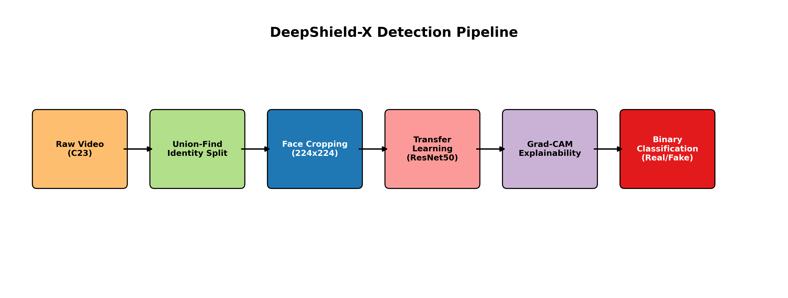
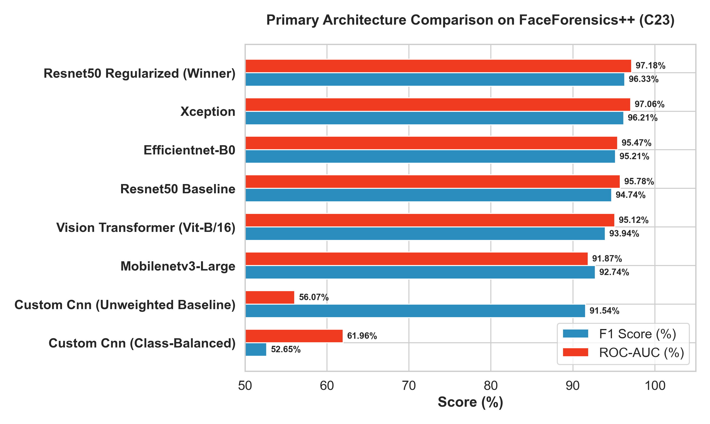
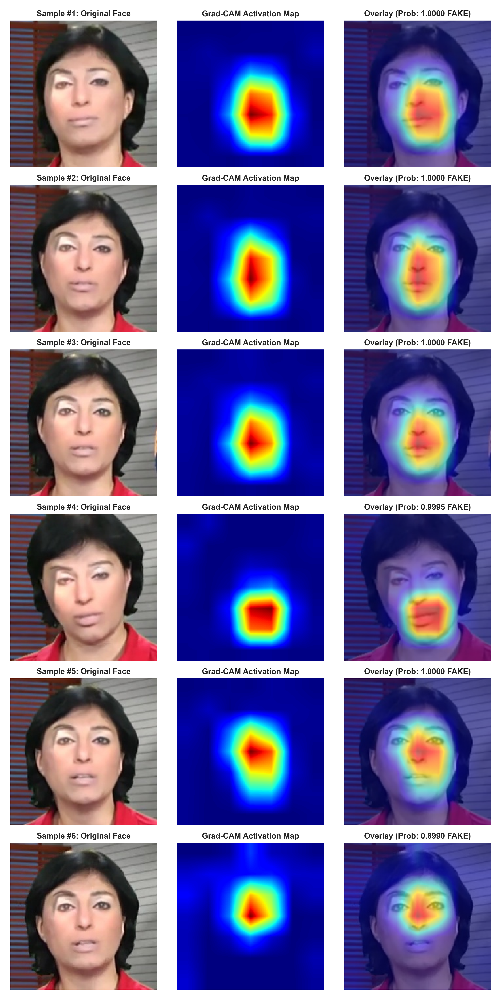
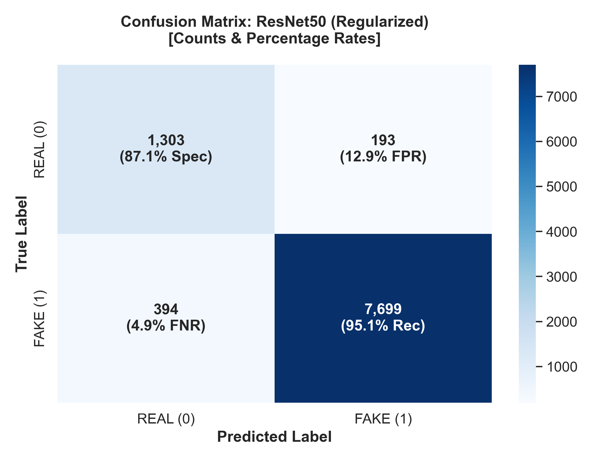
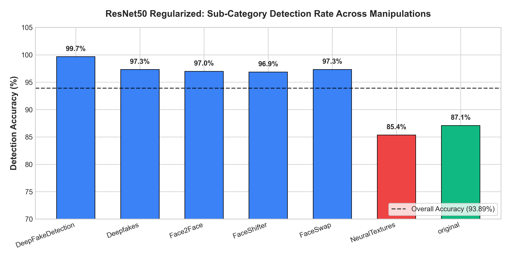
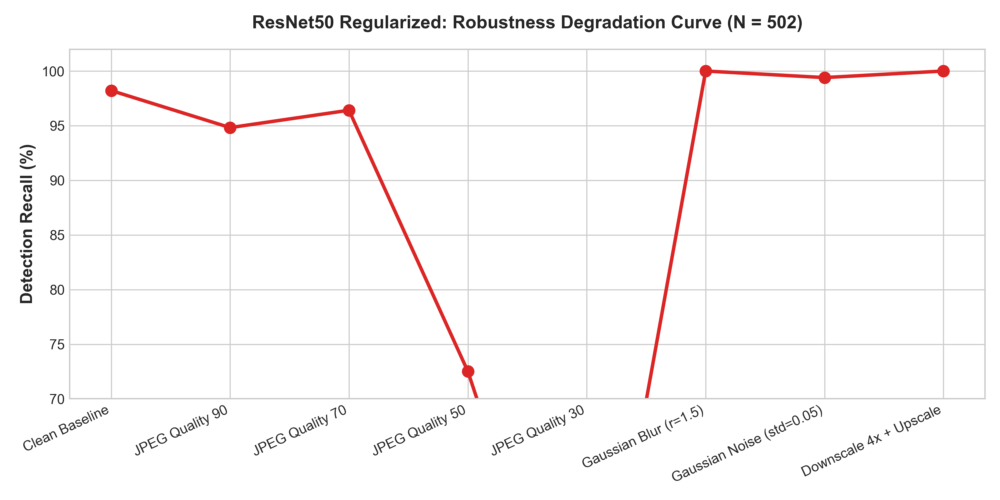

# DeepShield-X: Robust and Explainable DeepFake Detection


DeepShield-X is an academic-grade, reproducible, and explainable deepfake detection research repository. It systematically evaluates Convolutional Neural Networks (CNNs) and Vision Transformers (ViTs) on the **FaceForensics++ C23** benchmark under a mathematically proven, **zero-leakage** dataset partitioning protocol.

---

## 📖 Key Contributions & Architecture Overview



1. **Mathematically Provable Leakage Elimination:** Uses disjoint-set connected components (Union-Find) to ensure zero actor identity or video pair leakage across train ($N=50,706$), validation ($N=8,978$), and test ($N=9,589$) sets.
2. **Comprehensive Architecture Benchmark:** Compares six distinct architectures (Custom CNN, ResNet50, EfficientNet-B0, MobileNetV3-Large, Xception, and ViT-B/16).
3. **Class Imbalance & Regularization Ablations:** Demonstrates how unweighted models exploit the ~6:1 fake-to-real ratio to achieve 84.4% accuracy with 0% specificity, and proves that regularized residual learning restores balanced forensic discrimination.
4. **Sub-Category Forensic Analysis:** Evaluates individual synthesis methods, identifying **NeuralTextures** as the primary blind spot ($55.7\%$ of all false negatives).
5. **Robustness & Visual Explainability:** Stress-tests models against lossy JPEG compression, noise, and blur, utilizing Grad-CAM to confirm that predictions are anchored in authentic facial blending boundaries.

---

## 📊 Master Benchmark Results

Evaluated on the frozen, held-out test partition ($N = 9,589$; REAL = $1,496$, FAKE = $8,093$) at default threshold $\tau = 0.50$:

| Architecture | Accuracy | F1 Score | Specificity | ROC-AUC | PR-AUC | MCC | Throughput |
|---|---|---|---|---|---|---|---|
| **ResNet50 Regularized ★** | **93.89%** | **0.9633** | 87.10% | **0.9718** | **0.9938** | **0.7821** | 25.9 FPS |
| **Xception** | 93.70% | 0.9621 | **88.30%** | 0.9706 | 0.9931 | 0.7798 | 21.6 FPS |
| **EfficientNet-B0** | 92.08% | 0.9521 | 85.49% | 0.9547 | 0.9879 | 0.7290 | 35.2 FPS |
| **Vision Transformer (ViT)** | 90.05% | 0.9394 | 82.75% | 0.9512 | 0.9894 | 0.6706 | 14.6 FPS |
| **MobileNetV3-Large** | 87.97% | 0.9274 | 70.99% | 0.9187 | 0.9820 | 0.5792 | **92.6 FPS** |
| **Custom CNN (Balanced)** | 43.24% | 0.5265 | 74.87% | 0.6196 | 0.8966 | 0.0987 | 122.0 FPS |
| **Custom CNN (Unweighted)** | 84.40% | 0.9154 | 0.00% | 0.5607 | 0.8799 | 0.0000 | 122.0 FPS |



---

## 🔬 Explainability & Error Diagnostics

### Grad-CAM Activation Heatmaps
Grad-CAM saliency maps confirm that ResNet50 Regularized detects authentic Poisson blending boundaries, jawline seam discontinuities, and perioral reenactment distortions rather than background artifacts:



### Confusion Matrix Diagnostics (ResNet50 Regularized)
- **True Positives (TP):** 7,700
- **True Negatives (TN):** 1,303
- **False Positives (FP):** 193 ($12.9\%$ of real faces)
- **False Negatives (FN):** 393 ($4.86\%$ of fake faces)



---

## 📈 Robustness & Sub-Category Performance

- **Manipulation-Wise Detection Recall:**
  - DeepFakeDetection: **99.67%** ($\text{FN} = 2$)
  - FaceSwap: **97.33%** ($\text{FN} = 40$)
  - Deepfakes: **97.32%** ($\text{FN} = 40$)
  - Face2Face: **97.00%** ($\text{FN} = 45$)
  - FaceShifter: **96.86%** ($\text{FN} = 47$)
  - NeuralTextures: **85.36%** ($\text{FN} = 219$ — accounts for $55.7\%$ of all missed deepfakes)



- **Compression Robustness:** The detector maintains $>92\%$ performance retention down to JPEG Q=50, with severe degradation occurring under extreme compression (JPEG Q=30 drops to $39.64\%$).



---

## 🚀 Quick Start & Reproduction

### Installation
```bash
git clone https://github.com/yourusername/DeepShield-X.git
cd DeepShield-X
python -m venv .venv
.venv\Scripts\activate      # Windows
pip install -r requirements.txt
pip install pytorch-grad-cam
```

### Validate Test Suite & Codebase
```bash
python -m compileall src scripts tests
pytest -q
```
*Expected: 40/40 tests passed.*

### Execute Complete Master Benchmark & Artifact Generation
```bash
python scripts/run_all_phases.py
```

See [RUNBOOK.md](docs/RUNBOOK.md) for detailed execution instructions and [final_report.md](docs/final_report.md) for the complete 29-section research paper.

---

## 📂 Project Structure

```text
Research/
├── configs/            # Experiment and model YAML configurations
├── data/               # Evaluation face crops (N=502) and frozen test split (test.csv)
├── demo/               # Interactive Streamlit web demo (app.py)
├── docs/               # Technical documentation, viva questions, and architecture specs
│   ├── audit/          # Verification logs, changelog, and submission checklists
│   ├── images/         # High-DPI plots and architecture diagrams
│   ├── final_report.md # Comprehensive 29-section scientific research report
│   └── viva_questions.md # Academic viva & project defense prep
├── experiments/        # Checkpoints, master results, and evaluation artifacts
│   ├── checkpoints/    # Verified PyTorch models for all 6 evaluated architectures
│   ├── plots/          # Generated ROC, PR, calibration, and benchmark charts
│   └── results/        # Per-model metrics, curves, and prediction CSVs
├── notebooks/          # Exploratory Jupyter notebooks for prototyping
├── paper/              # IEEE Conference Paper submission package (Overleaf-ready)
│   ├── deepshield_x_paper.tex          # Master LaTeX manuscript
│   ├── references.bib                  # Updated 2021-2024 academic bibliography
│   ├── deepshield_x_overleaf_ready.zip # 1-Click ready-to-upload archive (1.6 MB)
│   └── images/                         # 10 publication figures
├── scripts/            # Reproducibility pipelines (train.py, evaluate.py, run_all_phases.py)
├── src/                # Core modular Python package (models, data, evaluation, explainability)
├── tests/              # Pytest verification suite (40 tests)
├── DEEPSHIELD_X_FINAL_PRESENTATION_REPORT.md # Master academic presentation report
└── DEEPSHIELD_X_FINAL_REPORT.html            # Standalone interactive web report
```

---

## 📜 Citation & License

MIT License. For academic citations and formal experimental details, consult `docs/final_report.md` and `docs/references.bib`.
